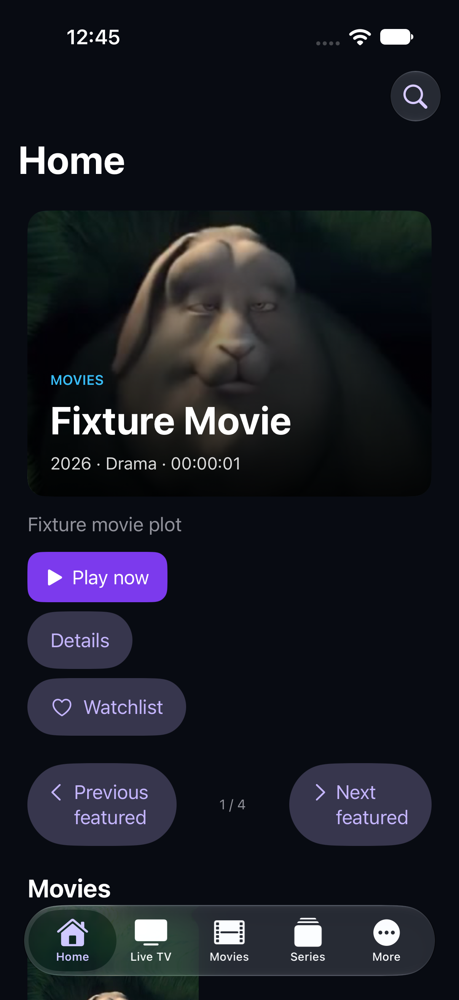
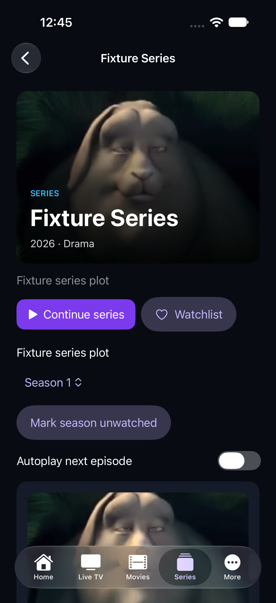
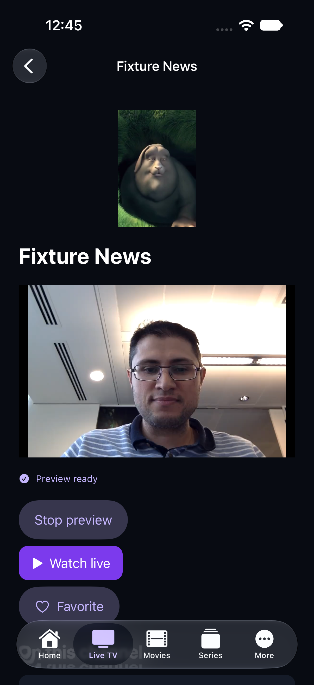
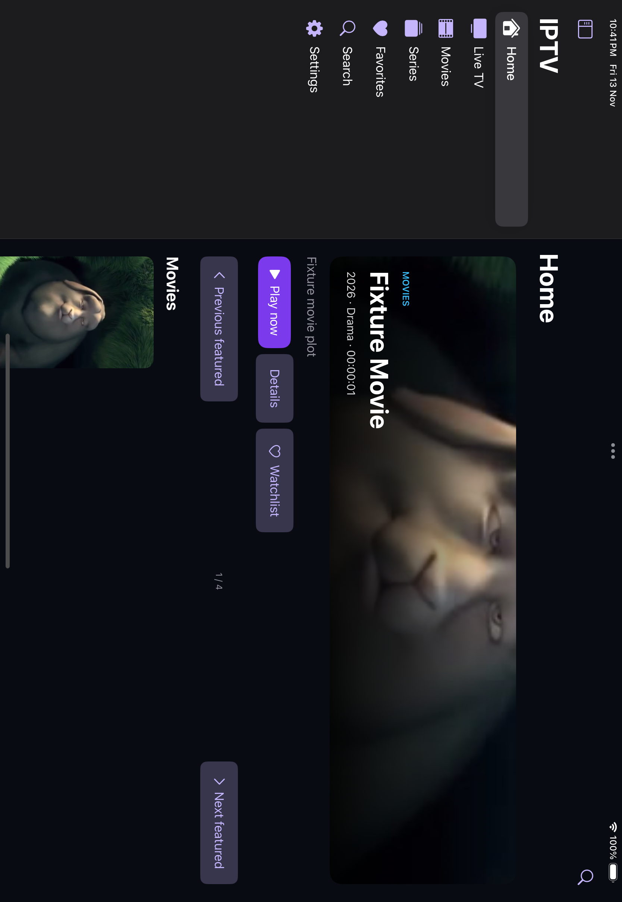
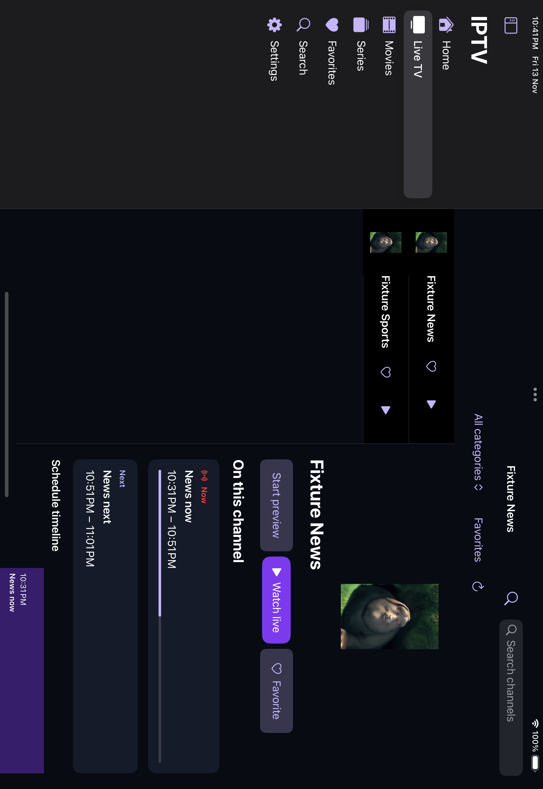
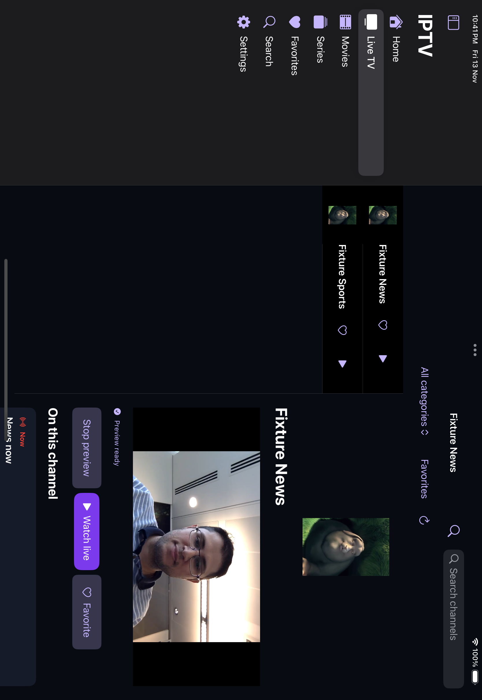

# Local validation evidence

See [the execution report](../MIGRATION_RESULTS.md) for commands, environments, outcomes and limits.

- `android-build-unit-lint.log`: migrated Gradle build, 39 JVM tests, lint completion.
- `android-instrumentation.log`, `android-device-tests.xml`: QA phone suite; 17 passed, 1 wide-display skip.
- `ios-core-tests.log`: final 20-test Swift core suite.
- `ios-analysis.log`: final Xcode analyzer success.
- `ios-iphone-summary.json`: final six-test iPhone result, including H.264 HLS readiness; no runtime warnings.
- `ios-ipad-suite-summary.json`: passing six-test iPad suite.
- `ios-ipad-flow-summary.json`: final iPad provider-flow recheck with H.264 HLS and background audio worker; no runtime warnings.
- `screenshots/`: unedited selected XCTest captures. Older Arabic captures use the app-only screenshot API; final iPad flow images use full-screen capture to preserve landscape orientation.

The test media is Big Buck Bunny, © Blender Foundation, Creative Commons Attribution 3.0; see `shared/test-fixtures/hls/NOTICE.md` and the Android test asset notice. Fixture names are test data, never a bundled production catalog.

## Selected screenshots

